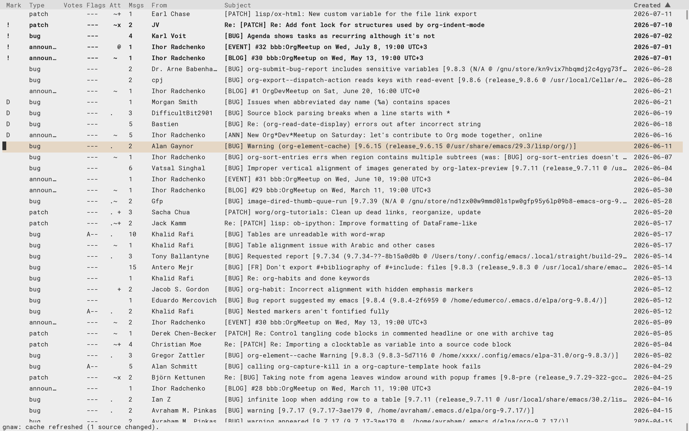

#+title: gnaw.el --- GNAW is Not Another Workflow

: 3==3      <= A gnawed bone.

[[https://www.repostatus.org/#active][https://img.shields.io/badge/status-active-brightgreen.svg?style=for-the-badge]]
[[https://intver.org/][https://img.shields.io/badge/versioning-intver.org-blue.svg?style=for-the-badge]]

=gnaw.el= lets you browse and manage [[https://codeberg.org/bzg/bone][BONE]] reports from Emacs.

BONE (/Backlog Of Notable Emails/) is a bug tracker that never asks
anyone to file a bug: it turns the =[BUG]=, =[PATCH]= or =[FR]= mails of a
mailing list into reports and publishes them as plain =reports.json=
files (see [[https://bzg.fr/en/notes/the-issue-with-issue-trackers/][The issue with issue trackers]]).

=M-x gnaw= lists the reports of the sources you follow: search them,
read their emails, view or apply their patches, and mark them sticky
or dismissed. =gnaw.el= is also the data layer of the [[https://codeberg.org/bzg/gnus-gnaw][gnus-gnaw]],
[[https://codeberg.org/bzg/notmuch-gnaw][notmuch-gnaw]] and [[https://codeberg.org/bzg/mu4e-gnaw][mu4e-gnaw]] mail front-ends.

#+caption: Gnaw summary

* Installation

=gnaw.el= requires Emacs 28.1 or later. On Emacs 30 or later, install it
with =package-vc=, along with its Info manual (=C-h i m gnaw RET=):

#+begin_src emacs-lisp
(use-package gnaw
  :init
  (unless (package-installed-p 'gnaw)
    (package-vc-install
     '(gnaw :url "https://codeberg.org/bzg/gnaw.el"
            :doc "doc/gnaw.org"))))
#+end_src

Update later with =M-x package-vc-upgrade RET gnaw RET=.

* Getting started

=M-x gnaw= opens the report browser. On the first run, it asks for a
source URL, the local git repositories where its patches apply, and
how to open report mail; =M-x gnaw-configure= reruns this setup.

For example, to read the [[https://tracker.orgmode.org][Org mode reports]], give it this URL:

: https://tracker.orgmode.org/reports/all-open.json

or write =~/.config/gnaw/config.edn= directly:

#+begin_src clojure
{:sources [{:urls ["https://tracker.orgmode.org/reports/all-open.json"]
            :name "Org mode ML"
            :repo "~/src/org-mode"}]}
#+end_src

In the browser, =h= lists all the key bindings and =/= filters the list
with =key:value= tokens.

* Documentation

The [[file:doc/gnaw.org][Gnaw manual]] covers everything else. Build it with =make info= or
=make pdf= (this needs Emacs 29 or later, =makeinfo= and =texi2pdf=).

* Contributing

- Send a [[mailto:~bzg/boneyard@lists.sr.ht][bug report]] with =[BUG] gnaw.el: <SHORT EXPLICIT BUG DESCRIPTION>=
- Send a [[mailto:~bzg/boneyard@lists.sr.ht][patch]] with =[PATCH] gnaw.el: <COMMIT SUMMARY>=
- Send a [[mailto:~bzg/boneyard@lists.sr.ht][feature request]] with =[FR] gnaw.el: <FEATURE REQUEST>=
- Share any [[mailto:~bzg/boneyard@lists.sr.ht <ANYTHING>][other question or idea]]

You can also [[mailto:bzg@bzg.fr][send me an email]] and support my work on [[https://liberapay.com/bzg/][liberapay]].

* Intentional Versioning

This project uses [[https://intver.org][Intentional Versioning]], with three audiences:

- =x=: end users
- =y=: indirect users, via the front-ends
- =z=: contributors to the codebase

* License

Copyright © 2026 Bastien Guerry

You can redistribute =gnaw.el= and/or modify it under the terms of the
GNU General Public License, either version 3 of the License, or (at
your option) any later version.
